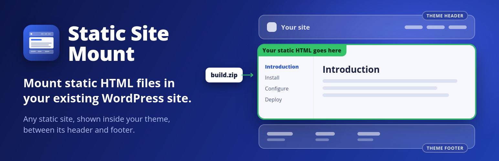
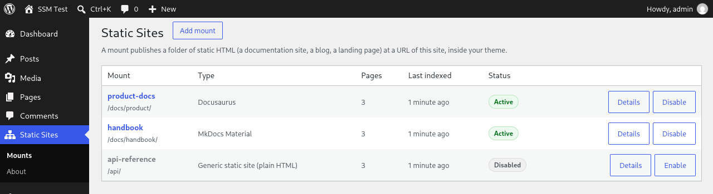
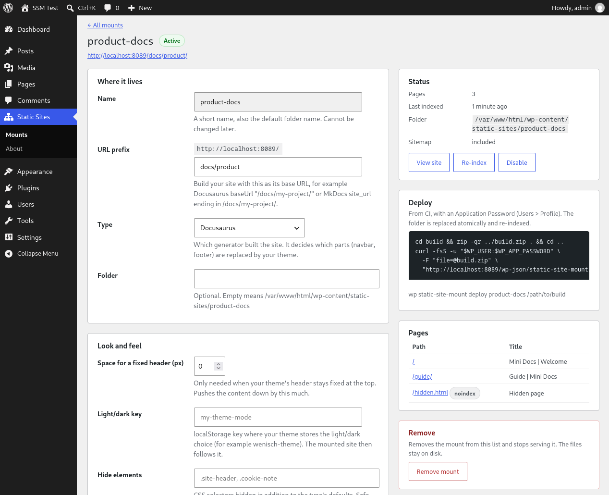
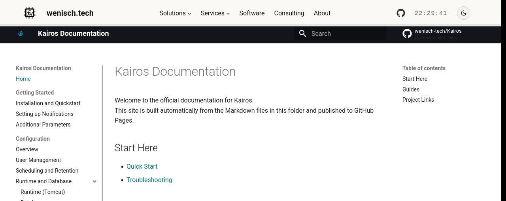

# Static Site Mount

[](https://github.com/wenisch-tech/wordpress-static-site-mount/releases/latest)
[](LICENSE)
[](#development)



Static Site Mount publishes a **built static site** (Docusaurus, MkDocs, Hugo, plain HTML) at a URL of your WordPress site, **inside your theme's header and footer**, with SEO tags and a sitemap, and lets you **deploy it from CI with one request**.

Typical use: product documentation built with Docusaurus lives at `https://example.com/docs/my-project/`, looks like part of your site, and updates itself on every release. No second domain, no iframe, no copy of your header in the docs project.


## What it does

- **Mounts a folder at a URL prefix.** Pages, assets and fonts are served through WordPress with correct MIME types, `ETag`/`304`, and long-lived caching for fingerprinted files.
- **Wraps pages in your block theme's header and footer**, so menu, branding and the light/dark switch are shared. The generator's own navbar and footer are hidden with CSS (JavaScript apps keep working) or removed on the server (plain HTML).
- **Writes the SEO tags itself:** title, meta description, canonical URL (rewritten to the mounted URL), Open Graph and Twitter tags, `noindex` support. Yoast SEO's tags are suppressed on these pages, so nothing is duplicated.
- **Sitemap:** `/ssm-pages.xml`, announced in Yoast's sitemap index and `robots.txt`.
- **Deploy from CI:** upload a zip to a REST endpoint; the folder is replaced atomically and re-indexed. WP-CLI commands are included.
- **Light/dark bridge:** the mounted site follows your theme's light or dark choice.
- **Safe by default:** only allow-listed file types are served, no dotfiles, no path traversal, archives are checked for zip-slip and executable files, and the files are not reachable directly from `wp-content`. A refused deploy leaves the live site untouched.
- **Own admin menu** with a mounts list, per-mount details, enable/disable and an About page with an environment check.

| Mounts | Mount details |
|---|---|
|  |  |



## Requirements

- WordPress 5.9 or later and PHP 7.4 or later (the `zip` extension is needed for deploys).
- A **block theme** for the header/footer wrapper. Classic themes get the page without the theme chrome; use the `ssm_header_html` and `ssm_footer_html` filters.
- Pretty permalinks (**Settings → Permalinks**).

## Installation

1. Download `static-site-mount-x.y.z.zip` from the [releases page](https://github.com/wenisch-tech/wordpress-static-site-mount/releases).
2. Go to **Plugins → Add New → Upload Plugin**, upload the ZIP and activate it.

Or unzip it into `wp-content/plugins/` and activate it there.

## Quick start

1. **Build your site with the mount prefix as its base URL.** Docusaurus:

   ```js
   // docusaurus.config.js
   url: 'https://example.com',
   baseUrl: '/docs/my-project/',
   trailingSlash: true,
   ```

   MkDocs: `site_url: https://example.com/docs/my-project/`.

2. Open **Static Sites → Mounts → Add mount**: name `my-project`, URL prefix `docs/my-project`, type *Docusaurus*. Optional: the localStorage key of your theme's light/dark choice, and the header height if your theme's header is fixed.
3. Deploy (see below). Done: `https://example.com/docs/my-project/`.

## Deploy from CI

Create an **Application Password** for an administrator (**Users → Profile**) and store it as a secret. After the build:

```bash
cd build && zip -qr ../build.zip . && cd ..
curl -fsS -u "$WP_USER:$WP_APP_PASSWORD" \
  -F "file=@build.zip" \
  "https://example.com/wp-json/static-site-mount/v1/mounts/my-project/deploy"
```

A complete GitHub Actions job is in [`examples/github-action-deploy.yml`](examples/github-action-deploy.yml). Use multipart (`-F file=@...`): PHP then keeps the upload on disk instead of in memory. A raw `--data-binary` body works for small sites.

A zip may have its files at the root or inside a single top-level folder. A build without a top-level `index.html`, or one containing a disallowed file type (for example `.php`), is **refused and the live site stays as it was**.

| Endpoint | Purpose |
|---|---|
| `GET  /wp-json/static-site-mount/v1/mounts` | list mounts, page counts, last index time |
| `PUT  /wp-json/static-site-mount/v1/mounts/<slug>` | create or update a mount (JSON) |
| `POST /wp-json/static-site-mount/v1/mounts/<slug>/deploy` | replace the folder with an uploaded zip, re-index |
| `POST /wp-json/static-site-mount/v1/mounts/<slug>/reindex` | re-index after files changed by other means (FTP, rsync) |

WP-CLI: `wp static-site-mount list | add | deploy | reindex`.

## Mount settings

| Setting | Meaning |
|---|---|
| Name | short name, also the default folder `wp-content/static-sites/<name>/` |
| URL prefix | where the site appears, for example `docs/my-project`; must match the build's base URL |
| Type | preset for the generator: Docusaurus, MkDocs Material, or generic static site |
| Hide elements | CSS selectors hidden in addition to the preset (safe for JavaScript apps) |
| Remove elements | simple selectors (`tag`, `#id`, `.class`, spaces) removed on the server |
| Space for a fixed header | pushes the content below a fixed theme header |
| Light/dark key | localStorage key of the theme's light/dark choice |
| Title suffix | appended to page titles |
| Sitemap / noindex | list pages in the sitemap, or ask search engines not to index the mount |

A disabled mount is not routed and not in the sitemap; its files and settings are kept.

## Other generators

Choose *Generic static site* and set which elements to remove (for example `header.site-header, footer.site-footer`) or hide. To add a preset, use the `ssm_presets` filter:

```php
add_filter( 'ssm_presets', function ( $p ) {
    $p['hugo-book'] = array(
        'label' => 'Hugo Book', 'hide' => '.book-header, .book-footer',
        'remove' => '', 'theme_key' => '', 'css' => '',
    );
    return $p;
} );
```

Other hooks: `ssm_title`, `ssm_description`, `ssm_header_html`, `ssm_footer_html`, `ssm_host_css`, `ssm_mime_types`, `ssm_base_dir`, `ssm_allow_external_dirs` (allow absolute mount folders, off by default), and the action `ssm_deployed`.

## Limitations

- The mounted site's **CSS and your theme's CSS share one page.** Generator styles can collide with theme styles (headings, buttons). Check your pages and add overrides if needed.
- **Client-side routing needs the right base URL at build time.** The plugin does not rewrite URLs inside JavaScript bundles.
- Only the generator's own navbar and footer are replaced. Search boxes and version dropdowns that live in the navbar are hidden with it.
- One WordPress server only: no multisite-aware paths, no CDN purging.
- Yoast SEO is handled; Rank Math and other SEO plugins only partly.

## Development

Contributions are welcome: fork, branch, follow the [WordPress Coding Standards](https://developer.wordpress.org/coding-standards/wordpress-coding-standards/), open a pull request against `main`.

```bash
tests/run.sh up              # throwaway WordPress + MariaDB with the plugin, in Docker
tests/smoke.sh http://localhost:8089 docs/product
bin/build-zip.sh             # release zip without tests and dev files
```

The release build passes [Plugin Check](https://wordpress.org/plugins/plugin-check/) without errors or warnings. To run it, start the test environment with `SSM_SRC=<built folder> tests/run.sh up`, install `plugin-check` and run `wp plugin check static-site-mount`.

The logo and icons are generated by [`assets/src/make_logo.py`](assets/src/make_logo.py); the banner is [`assets/src/banner.html`](assets/src/banner.html).

## Security model

- **A mounted build is raw HTML and JavaScript served from your site's own origin.** Whoever can deploy can therefore run script on your site. Managing mounts and deploying need both `manage_options` and `unfiltered_html`; on multisite, site administrators do not have the latter, so only super admins can mount sites. Only deploy builds you trust.
- Every route needs authentication; CI uses an [Application Password](https://make.wordpress.org/core/2020/11/05/application-passwords-integration-guide/). Create it for a dedicated administrator account.
- Deploys accept only allow-listed file types (no `.php`, no executable-looking names such as `shell.php.png`), refuse unsafe paths (`..`, absolute paths, zip-slip), cap the unpacked size at 512 MB and 50,000 files, and swap the folder atomically. Mount folders always live inside `wp-content/static-sites/`.
- Files are served only through WordPress, with `X-Content-Type-Options: nosniff`. On **Apache** a generated `.htaccess` blocks direct access to the folder. On **nginx** add `location ^~ /wp-content/static-sites/ { deny all; }`, otherwise the raw files are also reachable without the theme wrapper.
- The plugin makes no external requests and collects no data.

Please report vulnerabilities through a [private security advisory](https://github.com/wenisch-tech/wordpress-static-site-mount/security/advisories/new) rather than a public issue.

## License

[GPL v2 or later](https://www.gnu.org/licenses/gpl-2.0.html), the same license as WordPress.
